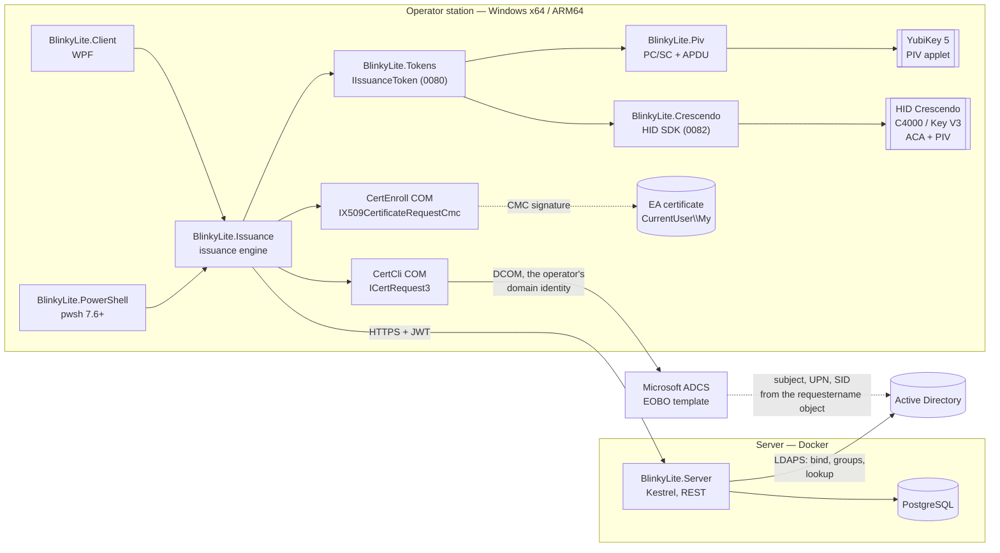
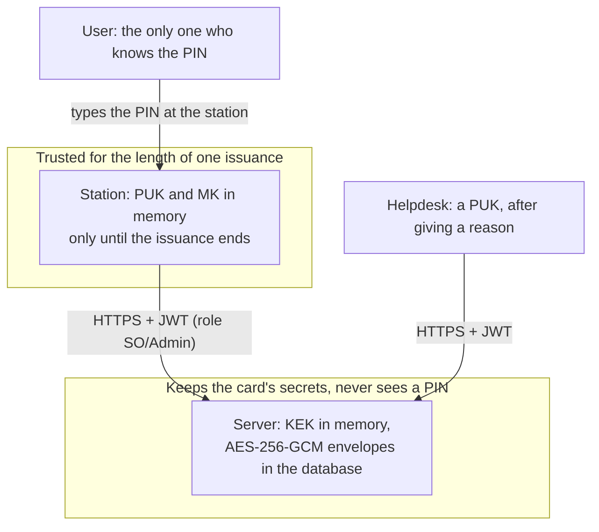
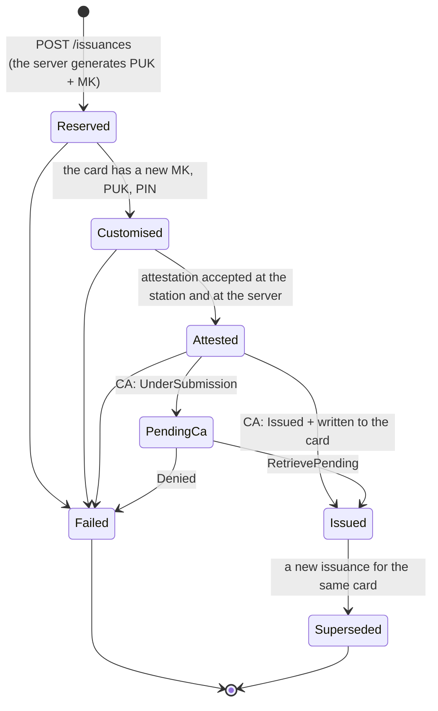

# 01 — Architecture

## What it is for, and what is not here

BlinkyLite exists because the full CMS (Blinky) is too big for a team that only
wants to **issue a PIV key from ADCS and not lose the PUK**. Everything that
does not serve that one purpose is out of scope:

| Out of scope | Why |
|---|---|
| Built-in CA, Samba4, CES/CEP | ADCS only, and only through the Windows mechanism |
| Background agent, job queue, SignalR | Issuance is interactive and synchronous, at the station |
| Renewals, CRL/OCSP | ADCS / Blinky. After 1.0 BlinkyLite only **notifies**, through a Teams bot, that a certificate is about to expire (0060, [09](09-expiry-notification.md)) |
| Profile and role-mapping editors in the UI | The server's `appsettings.json` |
| PUK change / rotation, card lifecycle beyond issuance | That is **Blinky**'s job |
| PIV reset outside Recycle, `SET PIN RETRIES` | `ykman` or Blinky |

After issuance BlinkyLite touches a card in **verification** mode only: it
reads the serial, the certificate and the attestation from 9A and compares them
with what was recorded at issuance. It writes nothing.

## Components

**One engine, two shells.** All of the issuance logic — card personalisation,
attestation, building the CMC, submitting it to the CA, talking to the server —
lives in `BlinkyLite.Issuance`. The WPF client and the PowerShell module only
collect input (target user, template, PIN) and show progress. That is what
makes both of them issue identically, and what lets them share tests. The
engine reports progress through `IProgress<IssuanceStep>` and asks for a PIN
through `IPinPrompt` — WPF implements it with a window, PowerShell with
`Read-Host -AsSecureString` / `PSHostUserInterface`.

**The engine does not know what kind of token it is holding (0080, D-42).** It
talks to the token through `IIssuanceToken` from `BlinkyLite.Tokens`, a project
of its own because the unblock application needs a token (`IToken`, without
the half that writes) and must not be able to see the issuance engine (D-36).
A token is opened with `TokenAccess.Open`; underneath, a YubiKey goes through
`BlinkyLite.Piv` and an HID Crescendo through the HID SDK in
`BlinkyLite.Crescendo`, the only project that sees `CrescendoDLL`. Family
differences (admin key in PIV or in ACA, serial or CUID, Yubico attestation or
none) stop at the driver; if an `if` about the token family appears in the
engine or in a shell, it is in the wrong place.

**The server talks to neither the CA nor the card.** Its jobs: authenticate the
operator against AD and issue a JWT, look the target user up in AD, generate
and keep the card's encrypted secrets, verify the attestation and the
certificate on its own side, keep the audit trail, and serve the browser
console. That is what lets the server be a Linux container with no DCOM and no
domain membership.

**Windows issues the certificate.** The station builds the CMC request with
CertEnroll (`IX509CertificateRequestCmc`, `SignerCertificate` = the EA
certificate, `RequesterName` = `DOMAIN\user`) and submits it through
`ICertRequest3` as the signed-in operator. The template, the subject, the UPN
and the SID extension are decided by ADCS from AD. The hand-written CMC builder
from Blinky (`CmcRequest.cs`), which works in the lab, is the fallback — see
D-04.

## How the server is deployed

| | Docker |
|---|---|
| Host | Linux, `docker compose` |
| Image | `mcr.microsoft.com/dotnet/aspnet:10.0` + `libldap`; published as `ghcr.io/franeksoftsf/blinkylite-server` and `-web` (D-39) |
| PostgreSQL | a container in the compose file, or an external server |
| TLS | Kestrel, certificate from a volume |
| KEK | environment variable or Docker secret |
| Configuration | `appsettings.json` from a volume + environment |
| AD sign-in | LDAPS bind |

**One way, not two (D-38).** The server was once also planned as a Windows
service in an MSIX package; that is off. Two installation methods are two sets
of paths, file permissions and secret sources, one of which gets tested rarely
— and the server is plain `net10.0` with nothing in it that needs Windows.
Windows stays on the station side: the client, the PowerShell module and the
PIN unblock application.

Database migrations are run by the server with `--migrate`, under a separate
schema-owner account — see [07 — Database](07-database.md#migrations). Issuance
profiles (ADCS template, CA, algorithm, PIN/touch policy) and the mapping of AD
groups to roles are the `Profiles` and `Roles` sections of `appsettings.json`.

## MSIX installation

| Package | Contents | Notes |
|---|---|---|
| `BlinkyLite-Unlock-<version>-<x64 \| arm64>.msix` | the "Unblock PIN" window for the card holder (0056) | a separate package, because it has a different audience: the link is on the web console's **sign-in page**, before anybody signs in. No alias, no module, no issuance engine |
| `BlinkyLite-Client-<version>-<x64 \| arm64>.msix` | WPF + engine, CardLab in its **station** edition and the PowerShell module (D-35) | a desktop shortcut (`desktop7:Shortcut`); the aliases `blinkylite` and `blinkylite-cardlab` for cmd — MSIX does not change `PATH`, and an alias is its way of being on it; **x64 and ARM64 are two packages, not a bundle** — MSIX names the architecture in its manifest and Windows installs only the matching one, and two runs of the same script cost less than one bundle that needs a separate tool to assemble and two signatures. The console offers the package for the reader's processor, and the **Tools** page lists both, with the architecture next to the version. Built by `packaging/client/Build-Msix.ps1` |
| the PowerShell module | **inside the client MSIX**, in `Modules\BlinkyLite` | a package's files live in `WindowsApps`, outside `PSModulePath`, and MSIX has no install step — so the application copies the module at start into the user's `Documents\PowerShell\Modules\BlinkyLite\<version>` (`ModuleInstaller`). This reverses the `.nupkg` of D-11 (D-35) |

Every package is signed with a code-signing certificate from the corporate
ADCS; stations and the server have to trust it (GPO). Windows will not install
an unsigned MSIX. The template, the certificate and the signing step by step:
[packaging/INSTRUKCJA-PODPIS.md](../packaging/INSTRUKCJA-PODPIS.md).

The same programs are also published as plain zips in each release, so an
engineer can unpack and run them without an installer or a signature — see
[14 — Install guide](14-install-guide.md).

## Roles and trust boundaries

| Role (AD group → the `role` claim) | May |
|---|---|
| `Admin` | everything: issue, browse, PUK, management key, audit log |
| `SecurityOfficer` | issue, browse, PUK |
| `Helpdesk` | the list of user — token — date; a PUK only after picking one entry (WPF) or naming the user/serial (PowerShell). No certificate or attestation details, no card verification |

An operator in several groups gets the union of the privileges. A user in none
of them gets no token (403 `error.auth.no-role` — the password was correct, so
this is not a failed sign-in).

The `Admin` and `SecurityOfficer` groups are also the Enrollment Agent groups
on the CA (D-17): if somebody can issue a card in BlinkyLite, it is because the
CA allows them to.

Two identities take part in one issuance: the **JWT** tells the server who the
operator is in BlinkyLite; **Windows** tells the CA who is submitting the EOBO
request and whose EA certificate it is. They may differ (an `adm-` account for
Windows and an ordinary one for BlinkyLite, say). The audit trail records both.

## Issuance state

`Failed` after `Reserved` does **not** delete the secrets: if the card did get a
new management key, the envelope in the database is its only copy. Details in
[02 — Issuing a key](02-issuance.md#recovery).

## Decisions

| ID | Decision | Why |
|---|---|---|
| D-01 | .NET 10 everywhere; the client is `net10.0-windows`, RIDs `win-x64` and `win-arm64` | one platform, and CertEnroll and WinSCard are native on ARM64 |
| D-02 | The PIV layer comes from `Blinky.Piv`, not the Yubico SDK | code measured against 5.4.3, 5.7.1, 5.8.0 and Bio; the rules from those measurements are already in it |
| D-03 | The server generates the PUK and MK **before** anything touches the card | the secret exists in the database before the card has it — a station crash cannot lose a key |
| D-04 | CMC through CertEnroll; the hand-written builder from Blinky as a fallback | the requirement is "the process built into Windows"; the Blinky builder is proven in the lab |
| D-05 | The management key is random and stored (not derived as in Blinky) | the requirement: the MK goes into the database and an Admin can read it |
| D-06 | The MK is also written to PRINTED behind the PIN, with the ADMIN DATA flag — **on by default, but a profile switch since D-48** | otherwise the Yubico minidriver overwrites the MK with a random one and blocks the PUK (Blinky, 08). A measurement on 23 November 2026 narrows this rule to cards with a **factory** MK: a card issued by HID CMS, with its own MK and no copy in PRINTED, keeps its PUK untouched on a station with the minidriver (15/15) — [12](12-hardware-notes.md#the-management-key-behind-the-pin-and-the-minidriver) |
| D-07 | NHibernate + FluentNHibernate for reading, read-only entities | a framework the project's owner knows; Fluent is simpler than the mapping-by-code from Blinky |
| D-07a | Writes go exclusively through the `bl_*` PL/pgSQL functions; the application role has no `INSERT/UPDATE/DELETE` | state rules and the audit entry, atomically, in the database, where they cannot be bypassed — [07](07-database.md) |
| D-07b | The schema is numbered SQL scripts, not generated from the mappings | with stored procedures, SQL is the source of truth; the mappings are checked against it by `SchemaValidator` |
| D-08 | JWT HS256, 30 minutes, no refresh token | one issuer and one audience; signing in again is cheap |
| D-09 | Sign-in is an LDAPS bind with the operator's own credentials | works from a Linux container with no domain membership |
| D-10 | The PowerShell module is binary, on the same engine | no drift between what WPF does and what PowerShell does |
| D-11 | MSIX as the installer (client bundle x64+ARM64, Windows server); the PS module as a `.nupkg` | the owner's decision; the module cannot live inside the MSIX (outside `PSModulePath`) |
| D-12 | Languages EN, DE, SV, PL; one `.resx` directory; the server returns codes and the client translates | the owner's decision — [08](08-localization.md) |
| D-13 | Profiles and role mapping in `appsettings.json`, with no editor in the UI | less code; editing in the UI is out of scope |
| D-14 | Helpdesk sees a list of user — serial — date; a PUK only after picking one entry, or naming it in PowerShell | the owner's decision; a separate list DTO, and no endpoint that returns several PUKs |
| D-15 | Translations are written by the AI together with the code, in plain language | the owner's decision; a glossary keeps the terms consistent |
| D-16 | After 1.0: an expiry notice from a one-way Teams bot (0060) | the owner's decision; the only code that runs without an operator, and it only informs — no bot SDK and no inbound endpoint |
| D-17 | The AD groups mapped to `Admin` and `SecurityOfficer` are the same groups that hold Enrollment Agent rights on the CA | the owner's decision; one list instead of two that can drift apart — the server refuses to start when both are empty |
| D-18 | The server's secrets come only from a secret file (Docker secret / machine DPAPI) or an environment variable; in `appsettings.json` they stop the start | the owner's decision; a password typed in "temporarily" stays forever — [04](04-security.md#secrets-on-the-server) |
| D-19 | The data can be exported to Blinky; the secrets in that package are encrypted to Blinky's certificate | the owner's decision; without it, moving to a full CMS means re-issuing every card — [10](10-blinky-export.md) |
| D-20 | The client's accent is `#1DB954` (the blog's green), both themes following the Windows setting | the owner's decision; the colour roles are kept apart, because that green gives 8.1:1 against black and only 2.6:1 against white — [02](02-issuance.md#colours-d-20) |
| D-22 | ~~PIV reset (wiping a card) **only in `tools/BlinkyLite.CardLab`**, never in the client or the module~~ **Partly superseded by D-44 (15 October 2026):** a reset exists in the product, but only as a Recycle step the server has authorised; outside that, still only CardLab's Lab edition | a test token has to return to its factory state between runs, and sending somebody to another tool for that ends in a half-provisioned card; the product still only issues and verifies, and `RESET` requires both PIN and PUK to be blocked, so it cannot happen by accident |
| D-21 | **Profiles live on the server** and are configured centrally by an admin; the client fetches them with `GET /api/profiles` and sends a profile name, never a template name | one change instead of a tour of the stations; the server writes the template into the issuance row from its own configuration, so the record is true even if a station was tampered with — what the station sends to the CA is the CA's business to police |
| D-45 | **Thales/SafeNet IDPrime MD cards are not supported — finally.** There is no second route to them and no revisiting it with the next Thales SDK | the owner's decision (16 October 2026); the test card has no PIV applet (`SELECT PIV` → `6A 82`), only the minidriver applet; Thales has no open SDK for physical cards (the SDK on thalesdocs.com/idpv is for IDPrime Virtual), and there the PIN unlocks the admin key in a challenge-response, not a PUK — [12](12-hardware-notes.md#thales-idprime-md), [05, Out of scope](05-roadmap.md#out-of-scope) |
| D-44 | **Token recycle and certificate revocation in the product.** The WPF client wipes the token (PIV reset) and revokes the certificates in ADCS through `ICertAdmin2` under the operator's domain identity; the server (Linux, D-38) talks to no CA and only keeps a durable queue of requests and their states. Recycle and asking for revocation: all three roles, Helpdesk included; carrying out a revocation: Admin and SecurityOfficer — and only where the CA allows it (a role in BlinkyLite grants nothing on the CA; an EOBO certificate is not a substitute for "Issue and Manage Certificates"). The revocation requests for every certificate of the token are written in the same transaction as the Recycle, **before** the reset; the reset happens only with the server's authorisation (a fresh TOTP code, a one-time nonce bound to the serial/CUID). The reset does not wait for the CA: after it the private key is gone, so the token can go back into use while the revocations stay queued. The lists (inventory, queue, history) are in the web console (D-25), the actions on the card and on the CA in WPF. Supersedes the part of D-22 about a reset in the product; CardLab Station still has no `reset` (D-35) | the owner's decision (15 October 2026); until then, wiping a card and revoking its certificate happened outside BlinkyLite (Crescendo Manager, `ykman`, the CA console), so the database said untrue things about the card and certificates from wiped cards stayed valid at the CA — [05, phase 9](05-roadmap.md#phase-9--token-recycle-and-revocation) |
| D-48 | **The MK behind the PIN is a profile switch, on by default.** A profile has a "keep the management key on the token, behind the PIN" field (column `protect_management_key`, migration 0016), changed by an Admin in the web console's settings, with a reason in the audit trail. On = as before: the Yubico minidriver reads the MK from PRINTED and **adds another certificate to the card on the PIN alone**. Off = neither the copy nor the flag is on the card, so every write after issuance needs the management key. BlinkyLite loses nothing by it: the MK is in an envelope on the server, and that is where recovery (0022), Recycle (D-44) and an Admin's reveal take it from. The self-check after issuance verifies what the profile asked for, not a constant — a card with no copy that turns out to have one does not pass | the owner's question (23 November 2026): a card from HID CMS asks for the management key when another certificate is added, and a BlinkyLite card does not, because it hands it over for the PIN. One device, one certificate — that the holder of the PIN can add a second one was not a decision, it was a side effect of D-06. On by default, because D-06 has a real cause and stations without the minidriver (0026) are not measured yet — [05, 0024](05-roadmap.md#phase-2--issuance) |
| D-43 | **A key with no manufacturer attestation only from a profile that allows it.** The C4000 has no PIV attestation (Q-11), so the proof of a Crescendo key's origin is an unsigned "generated on card" flag read by the station. A profile has an "allow keys without manufacturer attestation" switch, off by default; it is **kept in the database** and changed by an Admin in the web console's settings through a `bl_*` function, with an audit entry — not in `.env` and not in `appsettings.json`. The issuance records which proof it passed on. Requires profiles in the database (0031) before 0083 | the owner's decision (13 October 2026); a weaker proof has to be an administrator's conscious decision, visible in the settings and in the audit trail, not a consequence of what a card cannot do — [12](12-hardware-notes.md#key-attestation-on-the-c4000) |
| D-42 | **HID Crescendo tokens** (C4000, Key V3) alongside YubiKey: one token abstraction in the engine, Crescendo through the **HID SDK** rather than a home-grown ACA implementation; the SDK outside git | the owner's decision (13 October 2026); the ACA protocol is not publicly documented, and the SDK licence forbids reverse-engineering it through the SDK; the documentation repository is public, and the licence allows shipping the SDK inside an application, not redistributing it — [05, phase 8](05-roadmap.md#phase-8--hid-crescendo-tokens) |
| D-51 | Two repositories: the code is private, and a public one carries only `docs/` and the images | the owner's decision (24 November 2026); the history of this repository contains code, so the public one starts from an empty history and gets only what it is meant to show |
| D-52 | **English is the primary language of the documentation**, with the Polish translation in `docs/pl/`; a release carries the station packages and a server bundle that needs no source code | the owner's decision (24 November 2026); the documentation is what somebody outside reads first, and a reader who has to translate it is a reader who stops. The bundle exists for the same reason: "clone the private repository" is not an instruction an outside engineer can follow — [14](14-install-guide.md) |
