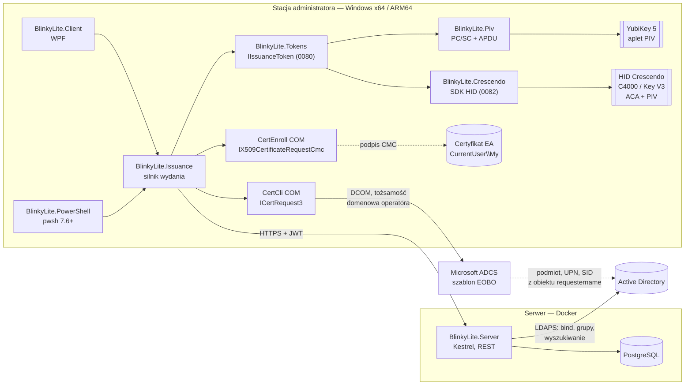
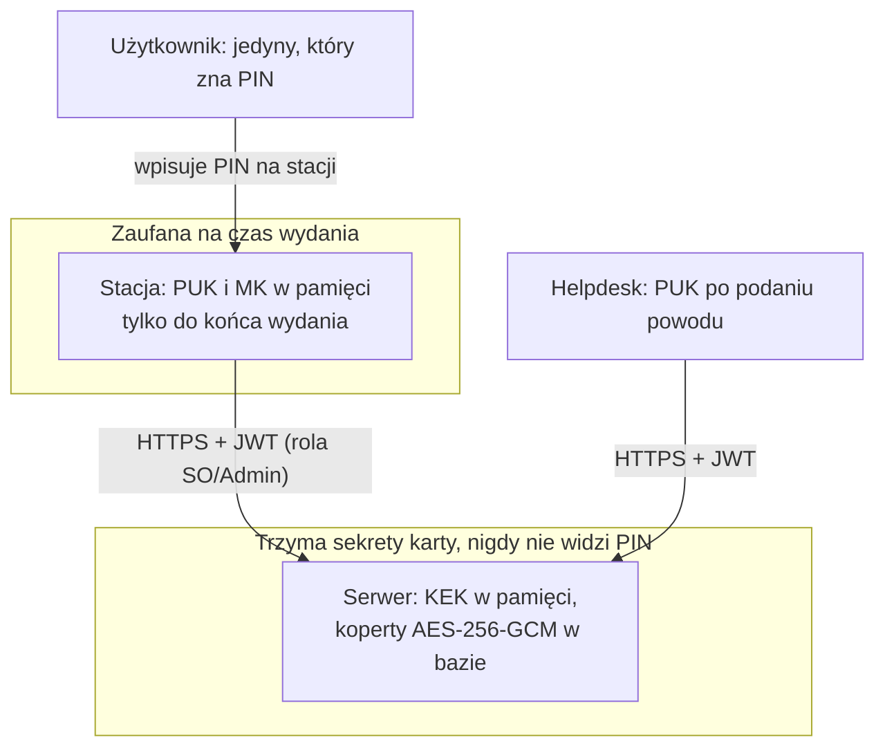
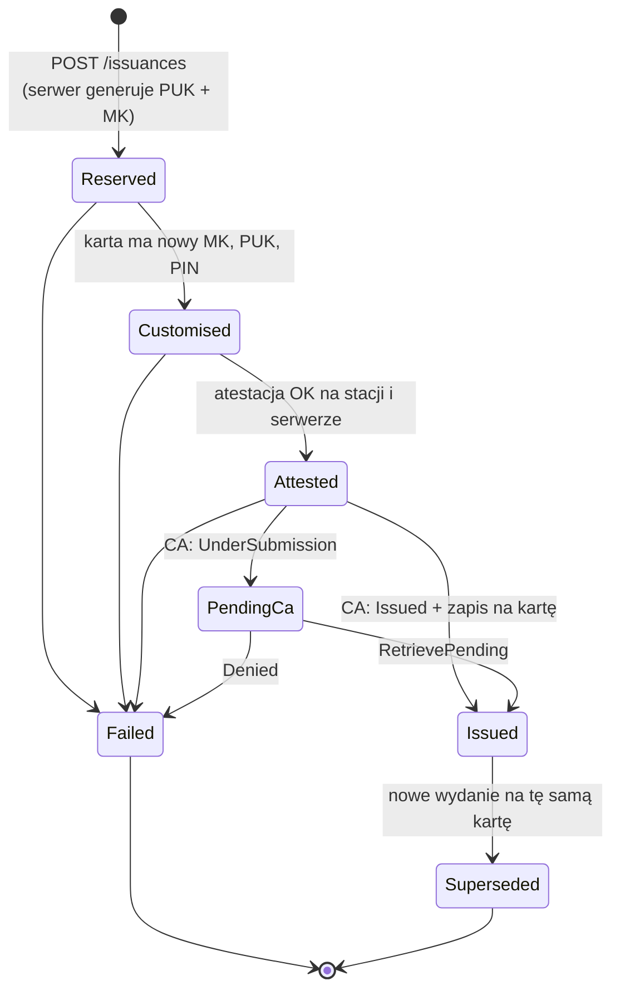

# 01 — Architektura

## Po co i czego tu nie ma

BlinkyLite istnieje, bo pełny CMS (Blinky) jest za duży dla zespołu, który
chce tylko **wydać klucz PIV z ADCS i nie zgubić PUK**. Wszystko, co nie służy
temu jednemu celowi, jest poza zakresem:

| Poza zakresem | Dlaczego |
|---|---|
| Wbudowane CA, Samba4, CES/CEP | Tylko ADCS, tylko przez mechanizm Windows |
| Agent w tle, kolejka zadań, SignalR | Wydanie jest interaktywne i synchroniczne na stacji |
| Odnowienia, CRL/OCSP | ADCS / Blinky. BlinkyLite po 1.0 tylko **powiadamia** przez bota Teams, że certyfikat wygaśnie (0060, [09](09-expiry-notification.md)) |
| Konsola webowa | Przeglądarka wydań jest w WPF |
| Zmiana / rotacja PUK, odblokowanie PIN, dalsze życie karty | To robi **Blinky** |
| Reset PIV, `SET PIN RETRIES` | `ykman` albo Blinky |
| Edycja profili i mapowania ról w UI | `appsettings.json` serwera |

Po wydaniu BlinkyLite dotyka karty już tylko w trybie **weryfikacji**:
odczyt serialu, certyfikatu i atestacji z 9A i porównanie z tym, co zapisano
przy wydaniu. Nic nie pisze.

## Komponenty

**Jeden silnik, dwie powłoki.** Cała logika wydania — personalizacja karty,
atestacja, budowa CMC, wysyłka do CA, rozmowa z serwerem — siedzi w
`BlinkyLite.Issuance`. WPF i moduł PowerShell tylko zbierają dane wejściowe
(użytkownik docelowy, szablon, PIN) i pokazują postęp. Dzięki temu oba
warianty wydają identycznie i mają te same testy. Silnik raportuje postęp
przez `IProgress<IssuanceStep>` i prosi o PIN przez interfejs
`IPinPrompt` — WPF implementuje go oknem, PowerShell przez
`Read-Host -AsSecureString` / `PSHostUserInterface`.

**Silnik nie wie, jaki to klucz (0080, D-42).** Silnik rozmawia z tokenem
przez `IIssuanceToken` z `BlinkyLite.Tokens` — osobnego projektu, bo aplikacja
do odblokowania potrzebuje tokenu (`IToken`, bez połowy, która zapisuje), a
silnika wydania widzieć nie może (D-36). Token otwiera `TokenAccess.Open`; pod nim YubiKey jedzie na `BlinkyLite.Piv`, a HID
Crescendo na SDK HID w `BlinkyLite.Crescendo` — jedynym projekcie, który
widzi `CrescendoDLL`. Różnice rodzin (klucz admina w PIV czy w ACA, serial
czy CUID, atestacja Yubico czy jej brak) kończą się na sterowniku; jeśli w
silniku albo powłoce pojawia się `if` o rodzinie klucza, jest w złym miejscu.

**Serwer nie rozmawia z CA ani z kartą.** Jego zadania: uwierzytelnić
operatora w AD i wystawić JWT, wyszukać użytkownika docelowego w AD,
wygenerować i przechować zaszyfrowane sekrety karty, zweryfikować atestację
i certyfikat po swojej stronie, prowadzić audyt, udostępnić przeglądarkę.
Dzięki temu serwer może być kontenerem Linux bez DCOM i bez członkostwa w
domenie.

**Wydanie certyfikatu robi Windows.** Stacja buduje żądanie CMC przez
CertEnroll (`IX509CertificateRequestCmc`, `SignerCertificate` = EA,
`RequesterName` = `DOMENA\użytkownik`) i wysyła je przez `ICertRequest3`
jako zalogowany operator. Szablon, podmiot, UPN i rozszerzenie SID ustala
ADCS na podstawie AD. Działający w labie ręczny builder CMC z Blinky
(`CmcRequest.cs`) jest planem awaryjnym — patrz D-04.

## Warianty wdrożenia serwera

| | Docker |
|---|---|
| Host | Linux, `docker compose` |
| Obraz | `mcr.microsoft.com/dotnet/aspnet:10.0` + `libldap`; wydany na `ghcr.io/franeksoftsf/blinkylite-server` i `-web` (D-39) |
| PostgreSQL | kontener w compose albo zewnętrzny |
| TLS | Kestrel, certyfikat z wolumenu |
| KEK | zmienna albo Docker secret |
| Konfiguracja | `appsettings.json` z wolumenu + env |
| Logowanie AD | LDAPS bind |

**Jeden sposób, nie dwa (D-38).** Serwer był kiedyś planowany również jako
usługa Windows w paczce MSIX; to odpada. Dwa sposoby instalacji to dwa
zestawy ścieżek, praw do plików i źródeł sekretów, z których jeden jest
sprawdzany rzadko — a serwer i tak jest czystym `net10.0` i nic w nim nie
potrzebuje Windows. Windows zostaje po stronie stacji: klient, moduł
PowerShell i odblokowanie PIN.

Migracje bazy uruchamia
serwer z `--migrate` na osobnym koncie właściciela schematu — patrz
[07 — Baza danych](07-database.md#migracje). Profile wydania (szablon ADCS,
CA, algorytm, polityka PIN/touch) i mapowanie grup AD na role są sekcjami
`Profiles` i `Roles` w `appsettings.json`.

## Instalacja MSIX

| Paczka | Zawartość | Uwagi |
|---|---|---|
| `BlinkyLite-Unlock-<wersja>-x64.msix` | okno „Odblokuj PIN" dla posiadacza klucza (0056) | osobna paczka, bo inna publiczność: link jest **na stronie logowania** konsoli web, przed zalogowaniem. Bez aliasu, bez modułu, bez silnika wydania |
| `BlinkyLite-Client-<wersja>-x64.msix` | WPF + silnik, CardLab w wydaniu **stacji** i moduł PowerShell (D-35) | skrót na pulpicie (`desktop7:Shortcut`); aliasy `blinkylite` i `blinkylite-cardlab` w cmd — MSIX nie zmienia `PATH`, alias jest jego sposobem, żeby w nim być; na razie tylko `win-x64`, ARM64 dojdzie jako bundle. Pobierany ze strony **Narzędzia** w konsoli web. Buduje `packaging/client/Build-Msix.ps1` |
| moduł PowerShell | **w MSIX klienta**, w `Modules\BlinkyLite` | pliki paczki leżą w `WindowsApps`, poza `PSModulePath`, a MSIX nie ma kroku instalacji — więc aplikacja kopiuje moduł przy starcie do `Dokumenty\PowerShell\Modules\BlinkyLite\<wersja>` użytkownika (`ModuleInstaller`). Odwołuje `.nupkg` z D-11 (D-35) |

Wszystkie paczki podpisane certyfikatem code signing z firmowego ADCS;
stacje i serwer muszą mu ufać (GPO). Niepodpisanego MSIX Windows nie
zainstaluje. Szablon, certyfikat i podpis krok po kroku:
[packaging/INSTRUKCJA-PODPIS.md](../packaging/INSTRUKCJA-PODPIS.md).

## Role i granice zaufania

| Rola (grupa AD → claim `role`) | Może |
|---|---|
| `Admin` | wszystko: wydanie, przeglądanie, PUK, management key, audyt |
| `SecurityOfficer` | wydanie, przeglądanie, PUK |
| `Helpdesk` | lista użytkownik — klucz — data; PUK dopiero po wybraniu wpisu (WPF) albo wskazaniu użytkownika/serialu (PowerShell). Bez szczegółów certyfikatu i atestacji, bez weryfikacji karty |

Operator z wieloma grupami dostaje sumę uprawnień. Użytkownik bez żadnej
z grup nie dostaje tokenu (403 `error.auth.no-role` — hasło było poprawne,
więc to nie jest nieudane logowanie).

Grupy `Admin` i `SecurityOfficer` są jednocześnie grupami Enrollment Agenta na
CA (D-17): jeśli ktoś może wydać kartę w BlinkyLite, to znaczy, że CA też mu
na to pozwala.

Dwie tożsamości w jednym wydaniu: **JWT** mówi serwerowi, kim jest operator
w BlinkyLite; **Windows** mówi CA, kto wysyła żądanie EOBO i czyj jest
certyfikat EA. Mogą się różnić (np. konto `adm-` do Windows i zwykłe do
BlinkyLite). Audyt zapisuje obie.

## Stan wydania

`Failed` po `Reserved` **nie** usuwa sekretów: jeśli karta zdążyła dostać nowy
management key, koperta w bazie jest jego jedyną kopią. Szczegóły w
[02 — Wydanie klucza](02-issuance.md#odzyskiwanie).

## Decyzje

| ID | Decyzja | Dlaczego |
|---|---|---|
| D-01 | .NET 10 wszędzie; klient `net10.0-windows`, RID `win-x64` i `win-arm64` | jedna platforma, CertEnroll i WinSCard są natywne na ARM64 |
| D-02 | Warstwa PIV przeniesiona z `Blinky.Piv`, nie Yubico SDK | kod sprawdzony na 5.4.3, 5.7.1, 5.8.0 i Bio; reguły z pomiarów już w nim są |
| D-03 | Serwer generuje PUK i MK **przed** dotknięciem karty | sekret istnieje w bazie, zanim karta go dostanie — awaria stacji nie gubi klucza |
| D-04 | CMC przez CertEnroll; ręczny builder z Blinky jako rezerwa | wymóg „proces wbudowany w Windows”; builder z Blinky jest sprawdzony w labie |
| D-05 | Management key losowy i przechowywany (nie wyprowadzany jak w Blinky) | wymóg: MK ma trafić do bazy i być odczytywalny przez Admina |
| D-06 | MK zapisany też w PRINTED za PIN-em + flaga ADMIN DATA — **domyślnie, ale od D-48 przełącznik profilu** | inaczej minidriver Yubico nadpisze MK losowym i zablokuje PUK (Blinky, 08). Pomiar z 23.11.2026 zawęża tę regułę do kart z **fabrycznym** MK: karta wydana z HID CMS, z własnym MK i bez kopii w PRINTED, ma na stacji z minidriverem nietknięty PUK (15/15) — [12](12-hardware-notes.md#23-listopada-2026-mk-za-pin-em-a-minidriver-pomiar-na-dwóch-kartach) |
| D-07 | NHibernate + FluentNHibernate do odczytu, encje tylko do odczytu | framework znany właścicielowi projektu; Fluent prostszy niż mapping-by-code z Blinky |
| D-07a | Zapis wyłącznie przez funkcje PL/pgSQL `bl_*`; rola aplikacji bez `INSERT/UPDATE/DELETE` | reguły stanów + audyt atomowo w bazie, nie do ominięcia — [07](07-database.md) |
| D-07b | Schemat w numerowanych skryptach SQL, nie generowany z mapowań | przy procedurach SQL jest źródłem prawdy; mapowania sprawdza `SchemaValidator` |
| D-08 | JWT HS256, 30 min, bez refresh tokenu | jeden wystawca i jeden odbiorca; ponowne logowanie jest tanie |
| D-09 | Logowanie przez LDAPS bind z poświadczeniami operatora | działa z kontenera Linux bez członkostwa w domenie |
| D-10 | Moduł PowerShell binarny, na tym samym silniku | brak rozjazdu zachowania WPF ↔ PowerShell |
| D-11 | MSIX jako instalator (klient bundle x64+ARM64, serwer Windows); moduł PS jako `.nupkg` | decyzja właściciela; moduł nie może żyć w MSIX (poza `PSModulePath`) |
| D-12 | Języki EN, DE, SV, PL; jeden katalog `.resx`; serwer zwraca kody, klient tłumaczy | decyzja właściciela — [08](08-localization.md) |
| D-13 | Profile i mapowanie ról w `appsettings.json`, bez edycji w UI | mniej kodu; edycja w UI poza zakresem |
| D-14 | Helpdesk widzi listę użytkownik — serial — data; PUK tylko po wybraniu jednego wpisu / wskazaniu w PowerShell | decyzja właściciela; osobny DTO listy, brak endpointu z wieloma PUK |
| D-15 | Tłumaczenia pisze AI razem z kodem, prostym językiem | decyzja właściciela; słowniczek pilnuje spójności terminów |
| D-16 | Po 1.0: powiadomienie o wygaśnięciu certyfikatu przez jednokierunkowego bota Teams (0060) | decyzja właściciela; jedyny kod działający bez operatora, tylko informuje; bez SDK bota i bez endpointu przychodzącego |
| D-17 | Grupy AD mapowane na `Admin` i `SecurityOfficer` to te same grupy, które mają uprawnienia Enrollment Agenta na CA | decyzja właściciela; jedna lista zamiast dwóch, które można rozjechać — serwer odmawia startu, gdy obie są puste |
| D-18 | Sekrety serwera tylko z pliku sekretu (Docker secret / DPAPI maszyny) albo zmiennej; w `appsettings.json` zatrzymują start | decyzja właściciela; „tymczasowo” wpisane hasło zostaje na zawsze — [04](04-security.md#sekrety-na-serwerze) |
| D-19 | Dane dają się wyeksportować do Blinky; sekrety w paczce zaszyfrowane do certyfikatu Blinky | decyzja właściciela; bez tego przejście na pełny CMS to ponowne wydanie każdej karty — [10](10-blinky-export.md) |
| D-20 | Akcent klienta `#1DB954` (zieleń bloga), oba motywy wg ustawienia Windows | decyzja właściciela; role koloru rozdzielone, bo ta zieleń daje 8,1:1 z czernią i tylko 2,6:1 z bielą — [02](02-issuance.md#kolory-d-20) |
| D-22 | ~~Reset PIV (kasowanie karty) **tylko w `tools/BlinkyLite.CardLab`**, nigdy w kliencie ani w module~~ **Częściowo zastąpione przez D-44 (15.10.2026):** reset w produkcie istnieje, ale wyłącznie jako krok Recycle autoryzowany przez serwer; poza nim dalej tylko CardLab Lab | token testowy musi wracać do stanu fabrycznego między przebiegami, a odsyłanie po to do innego narzędzia kończy się kartą w połowie sprowizjonowaną; produkt dalej tylko wydaje i weryfikuje, a `RESET` wymaga zablokowania PIN-u i PUK-u, więc nie da się go wykonać przez przypadek |
| D-21 | **Profile na serwerze**, konfigurowane odgórnie przez admina; klient pobiera je przez `GET /api/profiles` i wysyła nazwę profilu, nigdy nazwę szablonu | jedna zmiana zamiast obchodu po stacjach; do wiersza wydania szablon wpisuje serwer ze swojej konfiguracji, więc zapis jest prawdziwy nawet przy podmienionej stacji — tego, co stacja wyśle do CA, pilnuje CA |
| D-45 | **Karty Thales/SafeNet IDPrime MD nie są obsługiwane — ostatecznie.** Nie ma do nich drugiej drogi ani powrotu do tematu przy kolejnym SDK Thalesa | decyzja właściciela (16.10.2026); karta testowa nie ma apletu PIV (`SELECT PIV` → `6A 82`), tylko aplet minidrivera; Thales nie ma otwartego SDK do kart fizycznych (SDK z thalesdocs.com/idpv dotyczy IDPrime Virtual), a PIN odblokowuje tam klucz admina w challenge-response, nie PUK — [12](12-hardware-notes.md#thales-idprime-md-pomiar-i-decyzja), [05, Poza zakresem](05-roadmap.md#poza-zakresem) |
| D-44 | **Recycle tokena i unieważnianie certyfikatów w produkcie.** Klient WPF czyści token (reset PIV) i unieważnia certyfikaty w ADCS przez `ICertAdmin2` pod tożsamością domenową operatora; serwer (Linux, D-38) nie rozmawia z CA, tylko trzyma trwałą kolejkę żądań i stany. Recycle i żądanie unieważnienia: wszystkie trzy role, także Helpdesk; wykonanie unieważnienia: Admin i SecurityOfficer — i tylko wtedy, gdy CA na to pozwala (rola w BlinkyLite nie nadaje nic na CA; certyfikat EOBO nie zastępuje „Issue and Manage Certificates”). Żądania unieważnienia wszystkich certyfikatów tokena zapisane w tej samej transakcji co Recycle, **przed** resetem; reset tylko po autoryzacji serwera (ponowny kod TOTP, jednorazowy nonce związany z serialem/CUID). Reset nie czeka na CA: po resecie klucza prywatnego nie ma, więc token może wrócić do wydania, a unieważnienia zostają w kolejce. Listy (ewidencja, kolejka, historia) w konsoli web (D-25), akcje na karcie i na CA w WPF. Zastępuje D-22 w części o resecie w produkcie; CardLab Station dalej bez `reset` (D-35) | decyzja właściciela (15.10.2026); do tej pory wyczyszczenie karty i unieważnienie jej certyfikatu działy się poza BlinkyLite (Crescendo Manager, `ykman`, konsola CA), więc baza mówiła o karcie rzeczy nieprawdziwe, a certyfikaty z wyczyszczonych kart zostawały ważne w CA — [05, faza 9](05-roadmap.md#faza-9--recycle-tokena-i-unieważnianie) |
| D-48 | **MK za PIN-em to przełącznik profilu, domyślnie włączony.** Profil ma pole „trzymaj management key na tokenie, za PIN-em” (kolumna `protect_management_key`, migracja 0016), zmieniane przez Admina w ustawieniach konsoli web z powodem w audycie. Włączone = jak dotąd: minidriver Yubico czyta MK z PRINTED i **dokłada na kartę kolejny certyfikat po samym PIN-ie**. Wyłączone = na karcie nie ma ani kopii, ani flagi, więc każdy zapis po wydaniu wymaga management key. BlinkyLite nie traci przez to nic: MK jest w kopercie na serwerze i stamtąd bierze go odzyskiwanie (0022), Recycle (D-44) i odsłonięcie dla Admina. Samokontrola po wydaniu sprawdza to, o co prosił profil, a nie stałą — karta bez kopii, na której kopia jest, nie przechodzi | pytanie właściciela (23.11.2026): karta z HID CMS pyta o management key przy dokładaniu certyfikatu, a karta z BlinkyLite nie, bo sama go oddaje za PIN-em. Jedno urządzenie, jeden certyfikat — to, że posiadacz PIN-u może dopisać sobie drugi, nie było decyzją, tylko skutkiem ubocznym D-06. Domyślnie włączone, bo D-06 ma realną przyczynę i stacje bez minidrivera (0026) są jeszcze niezmierzone — [05, 0024](05-roadmap.md#faza-2--wydanie) |
| D-43 | **Klucz bez atestacji producenta tylko z profilu, który na to pozwala.** C4000 nie ma atestacji PIV (Q-11), więc dowodem pochodzenia klucza Crescendo jest niepodpisana flaga „wygenerowany na karcie”, odczytana przez stację. Profil ma przełącznik „pozwól na klucze bez atestacji producenta”, domyślnie wyłączony; **trzymany w bazie**, zmieniany przez Admina w ustawieniach konsoli web przez funkcję `bl_*` z audytem — nie w `.env` ani w `appsettings.json`. Wydanie zapisuje, jakim dowodem przeszło. Wymaga profili w bazie (0031) przed 0083 | decyzja właściciela (13.10.2026); słabszy dowód ma być świadomą decyzją administratora, widoczną w ustawieniach i w audycie, a nie skutkiem tego, że karta czegoś nie umie — [12](12-hardware-notes.md#13-października-2026-atestacja-klucza-na-c4000--nie-ma-q-11) |
| D-42 | **Klucze HID Crescendo** (C4000, Key V3) obok YubiKey: jedna abstrakcja tokenu w silniku, Crescendo przez **SDK HID**, nie własną implementację ACA; SDK poza git | decyzja właściciela (13.10.2026); protokół ACA nie jest opisany publicznie, a licencja SDK zabrania dochodzenia do niego przez SDK; repozytorium jest publiczne, a licencja pozwala dołączać SDK do aplikacji, nie udostępniać go — [05, faza 8](05-roadmap.md#faza-8--klucze-hid-crescendo) |
