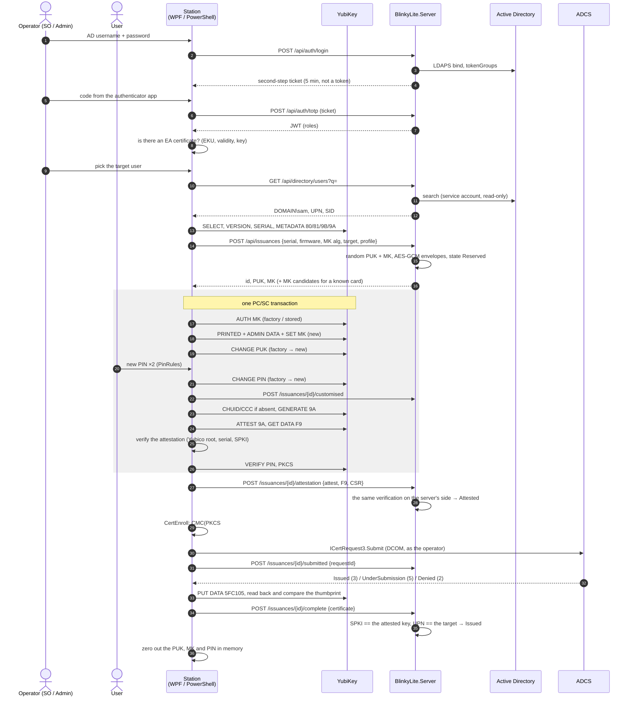

# 02 — Issuing a key

This document describes one issuance, from the operator signing in to the
certificate being on the card. The order of the steps is not arbitrary: most of
it comes from measurements made in Blinky ([06](06-from-blinky.md)), and the
rest from making sure no failure can leave a card holding a secret that is not
in the database.

## The sequence

## The steps, and the reasons

| # | Step | Detail | Why this way |
|---|---|---|---|
| 1 | Check the EA certificate **before** the card | EKU `1.3.6.1.4.1.311.20.2.1`, dates, private key present, no strong key protection | we do not personalise a card that cannot be issued anyway |
| 2 | The server picks the target | result: `DOMAIN\sAMAccountName`, UPN, `objectSid` | `RequesterName` must contain exactly one `\`; without it the CA issues the certificate to the operator |
| 3 | Read the card | `GET SERIAL` identifies a YubiKey; the MK algorithm comes **from `GET METADATA 9B`**, not from the firmware version | 3DES below 5.7, AES-192 from 5.7 on, with the same factory key bytes |
| 4 | Reserve at the server | the server draws a PUK (8 digits) and an MK (24 B), stores the envelopes, returns them to the station | D-03: the secret is in the database before the card has it |
| 5 | One PC/SC transaction | `SCARD_SHARE_SHARED` + `BeginTransaction` around the whole sequence | otherwise `SCARD_E_SHARING_VIOLATION` from polling or the minidriver |
| 6 | We do **not** send `SET PIN RETRIES` | the retry counters stay at their factory values | `00 FA` resets the PIN **and** the PUK to factory; out of scope for BlinkyLite |
| 7 | The new MK | PRINTED `5FC109` (`88 {89 key}`), flag `0x02` in ADMIN DATA `5FFF00`, then `00 FF FF FF <alg> 9B`. **A profile may skip the first two writes** (`ProtectManagementKey: false`, 0024) — then only `00 FF FF FF <alg> 9B` goes out | without PRINTED and the flag, the Yubico minidriver sets its own random MK and blocks the PUK — but only on a card with a factory MK ([12](12-hardware-notes.md#the-management-key-behind-the-pin-and-the-minidriver)). With the copy in PRINTED the minidriver adds another certificate on the PIN alone; without it, it asks for the management key (D-48) |
| 8 | The new PUK | `00 24 00 81` factory‖new | a PUK is not chosen by a human |
| 9 | The PIN, from the user | 6–8 digits; not 123456, not a repetition, not a run, not the PUK, not part of the serial number; typed twice | only the user knows the PIN; it never leaves the station |
| 10 | `/customised` | the server marks the envelopes active for this card | from this moment the card is "known" |
| 11 | CHUID `5FC102`, CCC `5FC107` | only if absent | without them Windows returns `NTE_BAD_KEYSET 0x80090016` at sign-in |
| 12 | `GENERATE 9A` | RSA-2048 by default, PIN policy `Once`, touch `Never` (a profile may change it) | the Windows credential provider ignores ECC without `EnumerateECCCerts` |
| 13 | Attestation | `00 F9 9A`, the intermediate from `5FFF01`, chain to the pinned Yubico root; serial, slot from the CN, SPKI | the intermediate differs on every device — only the root(s) are pinned |
| 14 | Sign the CSR | `VERIFY PIN`, then `00 87 <alg> 9A`; on `6982`, one more PIN prompt | YubiKey 5.8.0 invalidates an earlier PIN verification for a newly generated key |
| 15 | Verification at the server | step 13 repeated, plus the attestation and F9 stored | the server does not take the station's word for it; the attestation stays as evidence |
| 16 | CMC through CertEnroll | `IX509CertificateRequestPkcs10.InitializeDecode` → `IX509CertificateRequestCmc.InitializeFromInnerRequest`, `RequesterName`, `SignerCertificate` = EA, attribute `CertificateTemplate:<name>` | the requirement is "the process built into Windows" (D-04) |
| 17 | Submit | `ICertRequest3.Submit(CR_IN_BASE64 \| CR_IN_CMC, …, "HOST\CA CN")` as the signed-in operator | DCOM needs a domain identity |
| 18 | `/submitted` **before** waiting for the result | the `requestId` is recorded | without it, a certificate that was issued but not stored cannot be recovered |
| 19 | Write it to the card | `PUT DATA 5FC105` with CLA `0x10` chaining, then read back and compare the thumbprint | a ~1 KB certificate needs chaining |
| 20 | `/complete` | the server checks: the certificate's SPKI == the attested key, UPN/SID == the target | this closes the issuance; the card's previous issuance becomes `Superseded` |

**HID Crescendo (0083, D-43)** goes through the same steps in the same order,
through the driver on the HID SDK. The differences are in the driver, not the
engine: a CUID instead of a serial, the XAUTH key in the ACA applet instead of
an MK (factory is 24 × `00`, 3DES; being factory is established by
authenticating with it, because ACA does not say), the PUK written with XAUTH,
the PIN set through the PUK (`ResetPINTries`). **Steps 13 and 15 do not
exist** — the C4000 and the Key V3 have no attestation (Q-11). Instead the
station asks the card whether the key in 9A was generated on it
(`GeneratedOnToken`) and sends `KeyEvidence = GeneratedOnCard` to the server,
with no attestation. Only a profile with the "keys without manufacturer
attestation" switch accepts that: the station checks it before reserving (so no
secrets are created for nothing), the server checks it when reserving, and
`bl_issuance_attested` checks it once more when the evidence is stored, against
the profile as it stands in the database at that moment (`BL009`). The issuance
records which proof it passed on in `issuances.key_evidence`. Step 20 is
unchanged: the certificate's SPKI has to be the key from the CSR the card
signed.

## The card's state on arrival

| MK on the card | Serial in the database | What the engine does |
|---|---|---|
| factory | no | issuance as above |
| factory | yes | the card was reset outside BlinkyLite — a new issuance, the old one becomes `Superseded` |
| not factory | yes | authenticate with the MK candidates from the server (the active one first, then reservations newer than it); the PIN is set through `RESET RETRY` (`00 2C 00 80` PUK‖new PIN), because the PUK is known; slot 9A is overwritten after a confirmation |
| not factory | no | refused, with a message: the card has to be reset outside BlinkyLite (`ykman piv reset` or Blinky) |
| no PUK (Bio) | — | PUK `NotApplicable`, only the MK is stored |
| no PUK (not Bio) | — | refused: a card with the PUK disabled |

## Recovery

Every reservation binds **one pair** (PUK, MK). The order on the card is fixed:
MK → PUK → PIN. So after any failure the card's state can be established
without guessing and without burning PUK attempts:

| Failed after… | The card's state | How to resume |
|---|---|---|
| the reservation, before SET MK | factory | the next attempt makes a new reservation; the old one becomes `Failed` (the envelopes stay) |
| SET MK, before `/customised` | the MK from the reservation, the PUK either factory or from the reservation | whichever MK authenticates identifies the reservation; `GET METADATA 81` (the default flag) says whether the PUK has already been changed |
| `/customised`, before the CA | a known card | resume from GENERATE (overwriting the key in 9A) |
| Submit, before writing to the card | the certificate is at the CA, not on the card | `RetrievePending(requestId)`; write it if the SPKI == the key in 9A, otherwise a new issuance |
| `UnderSubmission` | waiting for a CA manager | `PendingCa`; "Resume" in WPF / `Resume-BlinkyLiteIssuance` |
| `Denied` | a known card with no certificate | `Failed`, with the CA's message verbatim; a new issuance will use the stored MK |

**Secret envelopes are never deleted.** A reservation that did not finish may
be the only copy of the management key of a card lying on somebody's desk.

## CMC and EOBO — what has to line up in ADCS

- An EA certificate from the *Enrollment Agent* template (or a copy of it), EKU
  `1.3.6.1.4.1.311.20.2.1`, in the operator's `CurrentUser\My`. If it lives on
  the operator's own card, Windows will ask for that card's PIN when signing.
- The target template: `msPKI-RA-Signature = 1`,
  `msPKI-RA-Application-Policies` = Certificate Request Agent; the subject
  built from AD (`msPKI-Certificate-Name-Flag` without bit `0x1`) — otherwise
  there is no SID extension `1.3.6.1.4.1.311.25.2` and sign-in fails after
  KB5014754.
- `msPKI-Minimal-Key-Size` is compared with the key length regardless of the
  algorithm: P-256 against a minimum of 2048 gives
  `0x80094811 CERTSRV_E_KEY_LENGTH`.
- The attribute carries the template's **name**, not its display name.
- The CA configuration: `HOST\CA CN`, e.g. `SUBCA\Corp Issuing CA`.
- **`RequesterName` travels in the RegInfo control (`1.3.6.1.5.5.7.7.18`) and
  is percent-encoded**: CertEnroll writes `requestername=DW-AD%5Cjkowalski`,
  because the pairs are joined with `&` and `=`, so the `\` has to survive
  them. When reading a CMC back, decode first — otherwise a correct name looks
  wrong (measured 20 September 2026, `WS-02`, Windows 11 26100).
- CertEnroll puts two controls into the PKIData — `1.3.6.1.4.1.311.10.10.1`
  (CMC attributes) and the RegInfo above — and **two** SignerInfos: one with no
  certificate in the envelope (for the requester) and one for the agent. That
  is the shape MS-WCCE requires.
- Errors known from the Blinky lab: `0x800706ba` (no domain identity),
  `0x80070005` (no rights), `0x80070002` (no such CA). Late-bound COM wraps
  exceptions in `TargetInvocationException` — unwrap before showing them.

## Profiles and templates (D-21)

There is more than one kind of card, so the template is not in the code. The
server has a list of **profiles** — in the database since 0031
(`issuance_profiles`), changed by an Admin in the web console (**Settings**);
`appsettings.json` only seeds an empty database, once, at the first start. The
operator picks a profile when issuing, and the profile carries everything that
makes one issuance different from another:

| Field | What it means |
|---|---|
| `Name` | what the operator sees in the list |
| `Template` | the ADCS template's **name**, not its display name |
| `KeyAlgorithm` | `Rsa2048` by default — ECC needs `EnumerateECCCerts` |
| `PinPolicy` | `Once`, `Always` or `Never` |
| `TouchPolicy` | `Never`, `Always` or `Cached` |
| keys without manufacturer attestation | off by default; only an Admin turns it on, in the console, with a reason in the audit trail, and only in the database — it cannot be set in a file (D-43). Without it the profile will not issue an HID Crescendo key, which has no attestation (0083) |
| enabled | a disabled profile stays in the database and in the settings, but stations do not receive it; profiles are not deleted |

**Profiles are configured centrally, by an administrator, on the server, and
the server is what hands them out.** The station has no file of templates: the
client asks `GET /api/profiles` (policy `CanIssue`) and gets what may be
issued. That makes changing a template one change in one place, instead of a
tour of the stations.

In an issuance request the client sends **the profile's name, never the
template's** — the server writes the template into the issuance row from its
own configuration. A profile that is not on the list is a refusal
(`error.profile.unknown`).

What this does **not** give you: the client receives the template's name,
because the client is the one talking to the CA — it builds the CMC and calls
`ICertRequest3.Submit`. A tampered station can therefore send the CA a request
for a different template. What stops it is the CA, not us (template
permissions, *Restricted Enrollment Agents*), and what stays on our side is a
record that will not agree with it: the issuance row carries the template from
the server's configuration, so the discrepancy is visible instead of absent.

**One profile is the normal case** — the client then asks nothing and simply
uses it. The choice appears on the issuance screen only when there is more than
one.

An issuance **copies** `Name` and `Template` into its own row (`profile_name`,
`template_name` in [03](03-data-model.md)). Changing a profile six months later
must not rewrite what has already been issued. Every profile change goes
through `bl_profile_save` with a reason, and the audit trail
(`profile.created`, `profile.changed`) keeps the profile as it was before and
after. A change takes effect with the next issuance, with no restart.

The template's name goes to the CA in the `CertificateTemplate:<name>`
attribute on `ICertRequest3.Submit`, not in the CMC. The station is told only
as much as it needs to carry out its own steps.

## The shells

### WPF (`BlinkyLite.Client`)

Four views:

1. **Sign-in** — AD username and password; the token is kept in the process's
   memory.
2. **Issue** (Admin, SecurityOfficer) — pick the user, the profile and the
   card, watch the progress step by step, the PIN window for the user (large,
   `Topmost`, a `PasswordBox`, the PIN rules checked as they type), and the
   result.
3. **Wipe a token** (Admin, SecurityOfficer, **Helpdesk** — D-44) and **carry
   out the revocations** (Admin, SecurityOfficer, where the CA allows it):
   [13](13-recycle.md). Helpdesk sees only the card and the wipe in that
   window.
4. **Verify** (Admin, SecurityOfficer) — a card in the reader: serial,
   certificate and attestation from 9A compared with what the database holds;
   who it was issued to, when, and by whom. Read-only — nothing is written to
   the card.
5. **Browser** — the list: user, token serial, issue date, state; search by
   user and by serial. The list **never contains a PUK** — a PUK appears only
   after picking one entry and clicking "Show PUK", which asks for a reason.
   That is all Helpdesk sees. Admin and SO also get: the issuance's details
   (certificate, attestation, operator) and search by certificate and by
   operator; "Show management key" and the "Audit" tab are for Admin only.

Patterns from `Blinky.Agent.Ui`: `InvariantGlobalization=false`, light/dark
theme from the registry, `Strings` (here reading the `.resx` files in four
languages), and a window deferred with
`Dispatcher.InvokeAsync(…, ApplicationIdle)`.

### Colours (D-20)

The accent is the green from the author's blog: **`#1DB954`**. Both themes,
chosen by default from the Windows setting (`AppsUseLightTheme`), with a manual
switch.

That green has a lightness that only works in one direction, so the colour's
role depends on the theme — the values below are calculated (WCAG 2.1, text
contrast ≥ 4.5:1):

| Use | Light theme | Dark theme |
|---|---|---|
| Fill (primary button, progress bar) | `#1DB954` with **black** text — 8.1:1 | `#1DB954` — 6.7:1 on `#1A1A1A` |
| Text and links in the accent colour | **`#0E7A38`** on white — 5.4:1 | `#3DDB74` on `#1A1A1A` — 9.6:1 |
| What we do not do | white text on `#1DB954` (2.6:1), or `#1DB954` as text on white (2.6:1) | — |

An issuance's state has a colour **and** a shape: a green ✓, a red ✗, a clock
for waiting. Colour alone cannot be the only carrier of information — in a
window a user and an operator are both standing at, somebody cannot tell red
from green.

### PowerShell (`BlinkyLite.PowerShell`)

A binary module on .NET 10, **requires pwsh 7.6+**. The same engine as WPF.

| Cmdlet | Role | What it does |
|---|---|---|
| `Connect-BlinkyLite -Server <url> [-Credential] [-Language en\|de\|sv\|pl]` | any | sign in, JWT kept in the PowerShell session; the message language defaults to `$PSUICulture` |
| `Get-BlinkyLiteCard` | any | cards in the readers: serial, firmware, MK/PIN/PUK state |
| `Find-BlinkyLiteUser -Query <text>` | SO, Admin | find the target in AD, through the server |
| `New-BlinkyLiteIssuance -User <DOMAIN\sam> -Profile <name> [-Serial]` | SO, Admin | a full issuance; the user types the PIN through `Read-Host -AsSecureString` |
| `Resume-BlinkyLiteIssuance -Id <guid>` | SO, Admin | resume a `PendingCa` or interrupted issuance |
| `Get-BlinkyLiteIssuance [-User] [-Serial] [-Since]` | any | the list (Helpdesk: user, serial, date, state; no PUK) |
| `Test-BlinkyLiteCard [-Serial]` | SO, Admin | verify the card in the reader against the database — read-only |
| `Get-BlinkyLitePuk (-Serial <n> \| -User <DOMAIN\sam>) -Reason <text>` | any | reveal the PUK of **one** card, audited; if the user has several cards, an error listing the serials, and `-Serial` has to say which. It takes no pipeline input, so PUKs cannot be pulled out in bulk |
| `Get-BlinkyLiteManagementKey -Serial <n> -Reason <text>` | Admin | reveal the MK, audited |

A PIN is not a parameter of any cmdlet — a parameter ends up in the PowerShell
history and in transcription logs. The only way in is an interactive prompt.
`Get-BlinkyLitePuk` and `Get-BlinkyLiteManagementKey` return a `SecureString`
by default; plain text only with `-AsPlainText` — because anything that reaches
a console's screen also reaches `Start-Transcript`, if somebody turned it on.
