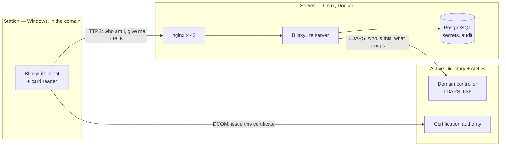

# 14 — Install guide: from nothing to an issued card

This is the hand-held version. It assumes you have never seen BlinkyLite, that
you administer a Windows domain with an enterprise CA, and that somebody has
asked you to make this work. Every answer the setup script wants is explained
here, together with what happens if it is wrong — because most of these
mistakes do not fail loudly. They fail two weeks later, at a desk, with a
person and a token waiting.

[11 — Requirements and deployment](11-requirements-and-deployment.md) is the
reference: tables, exact values, measurements from the lab. This document is
the order to do things in.

---

## 1. What you are building

Three machines, three jobs. None of them can do another one's job, and that is
deliberate.



- The **server** keeps secrets (PUK, management key), the audit trail and the
  list of who got what. It touches no card and talks to no CA.
- The **station** writes to the card and asks the CA for the certificate, using
  the operator's own Enrollment Agent certificate. It keeps nothing.
- **AD** says who the operator is and what they may do; the **CA** issues.

So: the server can be stolen and no card is issued from it; the station can be
stolen and it holds no PUK. What follows sets up the server, then points the
station at it.

---

## 2. Before you touch anything

Six things have to exist first. Each one takes minutes, and each one blocks the
step after it.

| # | What | How you know it is done |
|---|---|---|
| 1 | A Linux host with Docker, or Docker Desktop on Windows for a pilot | `docker compose version` prints 2.24 or newer |
| 2 | A DNS **A record** for the server | `nslookup blinkylite.corp.example` answers |
| 3 | A **TLS certificate** for that exact name, as a `.pfx` with its private key | you can open the `.pfx` with its password |
| 4 | A read-only **AD service account** | you can sign in with it anywhere |
| 5 | **Three AD groups**, and their SIDs written down | `Get-ADGroup` prints a SID for each |
| 6 | A **certificate template** for smart-card logon, and an **Enrollment Agent** certificate for at least one operator | `certutil -v -template` lists the template |

Items 5 and 6 are the ones people get wrong. Sections 5 and 6 below are about
exactly them.

> A record, not CNAME. Windows asks the KDC for a ticket for the name the
> client resolved to, so a CNAME makes Windows sign-in fail with no visible
> reason. An IP address never gets a Kerberos ticket at all — whoever types
> `https://192.0.2.89` gets the password form. That is intended.

---

## 3. Why Docker, why Linux, and what Windows changes

The server ships as a Docker image and only as a Docker image (D-38). There is
no MSI, no Windows service, and there will not be one. The reason is narrow:
this server is a database, a schema migration, a reverse proxy and a process
that has to read secrets as a specific user. Pinning all four to one image, with
one version number, is the difference between "it works on the lab server" and
"it works".

**On Linux** that is the whole story: Docker Engine, `docker compose`, done.

**On Windows**, Docker Desktop runs Linux containers inside a Linux virtual
machine, and you need to know which pieces of that are yours:

- **WSL 2** is that virtual machine. Docker Desktop's installer turns it on;
  if your organisation blocks WSL, the Hyper-V backend works too, and nothing
  here depends on which one you chose. *"Use the WSL 2 based engine"* is in
  Docker Desktop → Settings → General.
- **Linux containers, not Windows containers.** The tray icon can switch
  between them, and in Windows container mode nothing in this project runs.
  `setup.ps1` refuses to continue in that mode rather than letting Docker
  produce a confusing error later.
- **File permissions do not survive the boundary.** A file bind-mounted from
  Windows into a Linux container reports mode `0777` whatever its ACL says. The
  server notices this and warns about it on every start. The warning is
  correct: on Docker Desktop, the KEK is exactly as protected as the Windows
  account you are sitting in. `setup.ps1` tightens the ACL on `secrets\` so at
  least other accounts on the host cannot read it.
- **Docker Desktop needs somebody signed in.** It is a desktop application; it
  does not run as a service. A Windows host is therefore a pilot, a demo, a
  test — and a poor production server. The same bundle and `setup.sh` on a
  small Linux VM is the production answer.
- **Ports can be reserved out from under you.** Windows hands whole TCP ranges
  to Hyper-V and WSL, and a port inside one of them cannot be published even
  though nothing is listening on it. Docker's message is *"an attempt was made
  to access a socket in a way forbidden by its access permissions"*, which says
  nothing about reservations. `setup.ps1` checks
  `netsh interface ipv4 show excludedportrange protocol=tcp` and says so.
- **Port 443 is often taken** on a Windows server by IIS or the World Wide Web
  Publishing Service. Stop it, or run BlinkyLite on another port.

### Sizing

| | Minimum | Recommended | Why |
|---|---|---|---|
| CPU | 2 cores | 4 cores | the server idles; PostgreSQL and TLS want the rest |
| RAM | 2 GB | 4 GB | server ~200 MB, PostgreSQL the remainder |
| Disk | 20 GB | 50 GB | the database and the audit trail are never pruned |
| Network in | 443/tcp | + 80/tcp (redirect only) | from stations and browsers |
| Network out | 636/tcp to the domain controllers | | sign-in and user lookup |
| Clock | NTP | NTP | a token lives 30 minutes, TOTP codes 30 seconds |

On Proxmox, an LXC container needs `nesting=1` and `keyctl=1`. On ZFS storage
an unprivileged LXC will not get `overlay2` and falls back to `vfs`, which is
slow enough to notice — use a VM there.

---

## 4. What ends up on disk

Everything lives in one directory — `/opt/blinkylite` by convention — plus one
Docker volume for the database.

| Path | What | Who writes it | Survives a rebuild? |
|---|---|---|---|
| `.env` | every setting you answered | the setup script | only as your backup |
| `secrets/blinkylite-kek-1` | key that encrypts PUKs and management keys | the setup script, **once** | **must** — see below |
| `secrets/*-password`, `*-signing-key` | database passwords, JWT key, LDAP password | the setup script | yes, back them up |
| `secrets/blinkylite-http.keytab` | Kerberos key for Windows sign-in | you, from a domain controller | yes |
| `certs/blinkylite.crt`, `.key` | TLS certificate and key | the setup script, from your PFX | yes |
| `certs/ca/ldap-ca.crt` | your CA, so the container trusts LDAPS | you, optional | yes |
| `downloads/` | station installers the console offers | you, from a release | no, re-downloadable |
| `backups/` | database dumps you take | you | that is the point |
| volume `blinkylite_db-data` | PostgreSQL data | PostgreSQL | **yes** |

The volume is a named Docker volume, not a folder in this directory: on Linux
it is under `/var/lib/docker/volumes/blinkylite_db-data`, and `docker compose
down` leaves it alone. `docker compose down -v` deletes it, which is how you
throw away a pilot and the wrong command to type on a real server.

### The one irreversible thing

`secrets/blinkylite-kek-1` encrypts every PUK and every management key in the
database. Lose it and the database still has every row — and not one of them
can be read. Generate a new one and nothing in the old database opens.

So: **copy it off the host at install time, to somewhere that is not where the
database backups go.** A thief who gets both has every PUK of every card you
ever issued; a thief who gets one has nothing. This is the only part of this
document where "I'll do it later" has no recovery path. Details and the
reasoning: [04 — Security](04-security.md).

---

## 5. Active Directory: the account, the base DN, the three groups

### The service account

An ordinary user. No groups, no privileges, no mailbox. The server uses it to
look people up and to read their group membership — it signs nobody in, and
operators authenticate with their own credentials.

```powershell
New-ADUser -Name 'svc-blinkylite' -SamAccountName 'svc-blinkylite' `
    -Path 'OU=Service Accounts,DC=corp,DC=example' `
    -AccountPassword (Read-Host -AsSecureString 'password') -Enabled $true `
    -PasswordNeverExpires $true -CannotChangePassword $true
```

One thing it may need: if Windows sign-in (Kerberos) is in use, this account
reads other accounts' `tokenGroups`, and by default it may not be allowed to.
The symptom is specific — the server answers 503 and the log says *"tokenGroups
… came back empty"*. The fix is to add it to **Windows Authorization Access
Group**. With password sign-in this never happens, because then the operator's
own bind reads their groups.

### The base DN

The base DN is where a directory search starts. The server searches for the
person signing in, so it needs the top of the tree they live in.

For the domain `corp.example` it is `DC=corp,DC=example`. On a domain
controller:

```powershell
(Get-ADDomain).DistinguishedName
```

You can narrow it — `OU=Staff,DC=corp,DC=example` — and then people outside
that OU cannot sign in. That is a feature if you meant it. A wrong base DN
produces no error anywhere: the search simply finds nobody, and every sign-in
fails as though the password were wrong. The setup script suggests one derived
from your domain and checks that what you type at least looks like a DN.

### Three groups, by SID

| Group → role | May do | May not |
|---|---|---|
| Admin | everything: issue, revoke, details, PUK, **management keys**, audit log, settings | — |
| SecurityOfficer | issue, revoke, see details, see a PUK with a reason | read management keys |
| Helpdesk | see the **list**, get the PUK of **one named card** with a reason | see details, management keys, audit log |

**Why three.** These are three different amounts of trust. A helpdesk shift has
to be able to unblock somebody's PIN at 09:00 without also being able to read
every management key in the estate — and a management key is what lets you
rewrite a card. One group would mean every person who ever answers the phone
can do everything; two would mean the person who audits is the person who
issues. Three is the smallest number that keeps "unblock a PIN", "issue a card"
and "read everything" apart. The list a Helpdesk user sees never contains a
PUK; a PUK is always for one card, named, with a reason, and the reason is in
the audit trail before the value leaves the server.

**Why SID and not name.** A SID is permanent; a name is a label somebody will
rename at some point. If roles were matched by name, renaming
`BlinkyLite-Helpdesk` would silently remove everyone's access, and creating a
group with the old name would silently grant it. Neither is acceptable for a
system that hands out PUKs, so the configuration takes SIDs:

```powershell
Get-ADGroup 'BlinkyLite-Admins'           | Select-Object -ExpandProperty SID
Get-ADGroup 'BlinkyLite-SecurityOfficers' | Select-Object -ExpandProperty SID
Get-ADGroup 'BlinkyLite-Helpdesk'         | Select-Object -ExpandProperty SID
```

A domain group's SID starts with `S-1-5-21-`. If what you have starts with
`S-1-5-32-` it is a *built-in* group, local to one machine — the server will
never see anybody in it, and the setup script stops rather than letting you
configure it.

**Why Admin and SecurityOfficer are not free choices.** Those two roles issue
cards, and issuing means the station signs a request with the operator's
Enrollment Agent certificate. The CA checks that certificate, not BlinkyLite's
opinion. So the groups you map to Admin and SecurityOfficer must be the groups
that have `Enroll` on the Enrollment Agent template and on the target template
(D-17). Mapping a group the CA does not know produces an operator who can log
in, see everything, press *Issue* — and get an access-denied from the CA.

Nothing stops you from pointing two roles at one group. If Helpdesk is the same
group as Admin, your helpdesk reads management keys. The script says so and
continues; it is your estate.

---

## 6. The CA and the template

This is the part that takes longest if it is not already in place, and it is
the part BlinkyLite cannot do for you. What the template needs, and why:

| Setting | Value | Why |
|---|---|---|
| Purpose | Smartcard Logon + Client Authentication EKU | without them Windows will not sign in with the card |
| Issuance Requirements | **1 authorized signature**, policy type *Application policy*, policy **Certificate Request Agent** | this is what makes it Enroll On Behalf Of; the signature count alone would mean "any signature" |
| Subject name | **Build from this Active Directory information** — `msPKI-Certificate-Name-Flag` without bit `0x1` | the certificate then carries the SID extension, which Windows has required since KB5014754 |
| Minimum key size | ≤ 2048 | BlinkyLite issues RSA-2048 by default |
| Permissions | `Read` + `Enroll` for the operator groups (Admin, SecurityOfficer) | the CA weighs the **agent's** rights, not the card holder's |
| Validity | 1 year is typical | expiry notices (patch 0060) use 30 and 7 days, so validity must be longer |

Each operator also needs a certificate from the **Enrollment Agent** template,
in `CurrentUser\My`, with its private key. Consider *Restricted Enrollment
Agents* on the CA so an agent certificate cannot be used for arbitrary people.

The **CA configuration string** is the one value people mistype. It is
`HOST\CA common name`, and the authoritative source is the CA itself:

```powershell
certutil -config - -ping
```

Copy what it prints. `SUBCA\Corp Issuing CA` — the host part is the machine's
name, the second part is the CA's CN, and the separator is a backslash.

The **template name** is the name, not the display name. *Corp Smartcard
Logon* (display) is usually `CorpSmartcardLogon` (name). The CA compares the
name; a display name with spaces comes back as
`0x80094012 CERTSRV_E_TEMPLATE_DENIED`, which says nothing about names.

```powershell
Get-CATemplate | Format-Table Name, DisplayName
```

For revocation (phase 9, Recycle) the operators doing it need **Issue and
Manage Certificates** on the CA, and their station needs RSAT's AD CS tools:
`Add-WindowsCapability -Online -Name Rsat.CertificateServices.Tools~~~~0.0.1.0`.
Without those, revocation requests queue up and fail. See
[13 — Recycle](13-recycle.md).

---

## 7. The TLS certificate, from a PFX

The server will not start without HTTPS outside development, and nginx verifies
the server's own certificate against the name you configured. So the name on
the certificate, the name in DNS and the name people type must be the same
string.

### Getting the PFX

From a Windows machine, with the certificate already issued to the server's
name:

1. `certlm.msc` → Personal → Certificates → your certificate.
2. Right-click → All Tasks → **Export**.
3. **Yes, export the private key.** If this option is greyed out, the key was
   marked non-exportable when it was requested and no tool can change that —
   the certificate has to be requested again with an exportable key.
4. Format: *Personal Information Exchange — PKCS #12 (.PFX)*.
5. Tick **Include all certificates in the certification path if possible**.
   This is how the intermediate CA gets into the file, and without it clients
   that do not already hold your intermediate will reject the chain.
6. Encrypt with a password (TripleDES-SHA1 or AES256-SHA256 — both work).
7. Copy the `.pfx` to the server. Delete it afterwards: it contains the key.

### What the setup script does with it

It splits the PFX into the pair Kestrel reads — `certs/blinkylite.crt` and
`certs/blinkylite.key` — and checks four things that are each a silent failure
otherwise:

- the private key actually matches the certificate (a PFX can hold two
  identities);
- the chain goes into the `.crt` after the leaf, in order, because Kestrel
  sends whatever the file contains — and the self-signed root is dropped,
  since clients must trust that themselves anyway;
- the certificate has not expired, and warns if it will within 30 days;
- **the server's name is one of the certificate's names.** If it is not, nginx
  answers `502` on every `/api` call and the only clue is one line in its log:
  *upstream SSL certificate does not match*. The script refuses to continue.

If your PFX was exported with older defaults, OpenSSL 3 cannot read it with its
default provider (RC2 was moved out). The script retries with `-legacy` by
itself; you do not need to know this unless you are doing it by hand.

### No certificate yet

The script can write a self-signed one so a pilot can come up. Then every
station and browser has to be told to trust it, and nothing will do that for
you — which is why this is a pilot answer, not a deployment answer.

---

## 8. The run

Unpack the bundle where the server will live, and run the script. On Linux it
has to be root: the secrets must belong to the right uids, and only root can
hand them over.

```bash
sudo mkdir -p /opt/blinkylite
sudo tar xzf blinkylite-deploy-0.1.166.tar.gz -C /opt/blinkylite
cd /opt/blinkylite
sudo ./setup.sh
```

It goes through ten steps and stops at the first one it cannot honestly pass:

1. **The host** — Docker, compose 2.24+, openssl, disk, clock.
2. **Where the server answers** — name, ports, whether DNS agrees, whether
   something already holds 443.
3. **TLS certificate** — PFX import, or a pair you already have, or
   self-signed.
4. **Secrets** — generated once, kept forever after.
5. **Active Directory** — controller, transport, base DN, service account, and
   an LDAPS probe.
6. **The three groups** — SIDs, validated.
7. **CA and profile** — configuration string, template name, key and policies.
8. **`.env`** — written from `.env.example`, so a setting added upstream cannot
   quietly stay missing.
9. **Owners and permissions** — the step whose absence once produced a database
   with empty passwords that reported success.
10. **Pull, start, check** — images, containers, `/health`, `schema ok`.

The order inside the stack, which is also the order of the logs you will read:
PostgreSQL starts and creates three roles, gives them the passwords from the
secrets, then a one-shot `migrate` container applies the schema as the *owner*
role, and only then does the server start as the *application* role. The server
refuses to run against a schema it was not built for, so a half-finished
migration stops the deployment instead of corrupting it.

Done looks like this:

```
+ /health answers: {"status":"ok","version":"0.1.166"}
+ the mappings agree with the database (schema ok)
```

Run the script again whenever something changes. It keeps existing secrets,
backs up the old `.env`, and re-checks everything.

### Unattended

Every prompt reads an environment variable of the same name, so a second
deployment is a file of variables and one command:

```bash
set -a; . ./answers.env; set +a
sudo -E ./setup.sh --unattended
```

`--no-start` prepares everything and starts nothing, for a change window.

---

## 9. The first sign-in, and the stations

**The first sign-in of every operator happens in the browser.** Not in the WPF
client, not in PowerShell. A second factor is mandatory (D-31), and the console
is the only place that can show the QR code for an authenticator app and then
the ten recovery codes — once. Until an operator has done that, the same
account gets `error.totp.setup-required` everywhere else. Since patch 0029 a
FIDO2 security key can be the second factor instead of a code, chosen on the
operator's own page; a station still wants a code.

Open `https://<your server>/`, sign in as somebody in the Admin group, and
finish the setup. If that first sign-in fails, section 11 is a list of the five
reasons.

Then the station: a domain-joined Windows machine, an operator with an
Enrollment Agent certificate, a reader, and the client package from the same
release. Put the installers in `downloads/` and they appear on the console's
Tools page, which is the easiest way to get them onto a station.

The station does not need to be told the server's address by hand. One registry
value, through Group Policy, configures the whole fleet — and the same value is
read by the unblock application, which matters because somebody with a blocked
PIN should not have to know any addresses:

| | |
|---|---|
| Key | `HKLM\SOFTWARE\Policies\BlinkyLite` |
| Value | `Server`, `REG_SZ` |
| Example | `https://blinkylite.corp.example` |

---

## 10. Backup, restore, upgrade

### Backup

```bash
cd /opt/blinkylite
docker compose exec -T db pg_dump -U postgres -d blinkylite -Fc > backups/blinkylite-$(date +%F).dump
```

Back up `secrets/`, `certs/` and `.env` as well — and keep
`secrets/blinkylite-kek-1` in a *different* place from the dumps. A filesystem
snapshot of a running database is "as if the power was pulled": PostgreSQL will
survive it, but a dump is what you want to restore from.

Take a dump before every upgrade that carries a migration.

### Restore

Restoring is the one case where the script must not generate a KEK. Put the old
`secrets/blinkylite-kek-1` in place first, or answer *yes* to "are you
restoring a database from a backup", or pass it in `$BLINKYLITE_KEK`. Then
restore the dump into the fresh database:

```bash
cat backups/blinkylite-2026-11-24.dump | docker compose exec -T db pg_restore -U postgres -d blinkylite --clean --if-exists
```

A restore with a new KEK gives you a server that starts, lists every card, and
cannot decrypt a single PUK.

### Upgrade

```bash
cd /opt/blinkylite
# edit .env: BLINKYLITE_VERSION=0.1.170
docker compose pull
docker compose up -d
```

The `migrate` container runs first and prints *"database is up to date"* when
there is nothing new. Pin the version in `.env` rather than running `latest` on
a server somebody depends on: `latest` changes under you at the next release.

Replacing the TLS certificate is the same two steps as the first time — import
the new PFX (`sudo ./setup.sh`, answer *yes* to replacing the pair) and
`docker compose up -d --force-recreate api web`. The server reads the
certificate only at start.

---

## 11. When it does not work

| What you see | What it is | What to do |
|---|---|---|
| `502` on every `/api` call | the certificate's name is not `BLINKYLITE_SERVER_NAME`; nginx verifies it | fix the name or the certificate; `docker compose logs web` says *upstream SSL certificate does not match* |
| The console loads but sign-in fails for everyone | base DN searches nothing, or the service account password is wrong | `docker compose logs api`; re-run the script to re-enter both |
| `503` and *tokenGroups … came back empty* | the service account may not read other accounts' group membership | add it to **Windows Authorization Access Group** |
| PostgreSQL rejects the server's password on a fresh install | the secrets were created without root, so the database init could not read them | `sudo ./setup.sh` again on an **empty** volume: passwords are set once, when the data directory is created |
| `error.totp.setup-required` in the client | that operator has never signed in to the console | first sign-in is in the browser, always |
| `401` on *Sign in with Windows* | no keytab, or the browser does not treat the site as Intranet | leave it off, or follow the Kerberos section of [11](11-requirements-and-deployment.md) |
| `0x80094012 CERTSRV_E_TEMPLATE_DENIED` | template *display* name instead of its name, or the operator group has no Enroll | `Get-CATemplate`; check the template's permissions |
| `E_ACCESSDENIED` when revoking | the operator lacks *Issue and Manage Certificates*, or RSAT is missing on the station | grant it on the CA; install the AD CS RSAT capability |
| The server warns about secret permissions on every start | Docker Desktop reports `0777` for bind mounts | expected on Windows; it is a statement about the host, not a bug |
| `docker compose up` tries to **build** something | `COMPOSE_FILE` is not set, so the override that points at the published images is not in play | the setup script writes it into `.env`; check it is there |
| Docker cannot publish port 443 | something listens on it, or Windows reserved the range for Hyper-V/WSL | stop IIS, pick another port, or free the range |

Three commands answer most questions:

```bash
docker compose ps                  # what is running, and what keeps restarting
docker compose logs api --tail 50  # the server's own account of itself
curl -k https://localhost/health   # version and liveness, straight from the server
```

---

## 12. Things worth refusing to do

- **Do not point two environments at one KEK** and then restore one of them
  into the other. Envelopes are not interchangeable between databases.
- **Do not put the KEK in the same backup set as the database.** The whole
  design assumes those two copies live apart.
- **Do not grant the application database role `INSERT`/`UPDATE`/`DELETE`.**
  Every write goes through a `bl_*` function that checks state and writes the
  audit entry in the same transaction; a direct grant removes the audit trail
  without removing the write ([07](07-database.md)).
- **Do not edit a migration that has already been applied.** Its checksum
  stops the server. A change to a function is a new migration.
- **Do not hand a PUK out over the phone.** The unblock application can do it
  without anybody saying it out loud: the user reads a short code to the
  operator, the operator approves in the console, and the station fetches the
  PUK once and sets the new PIN ([04](04-security.md)).
- **Do not use `docker compose down -v` on a server.** That is the command that
  deletes the database volume.
